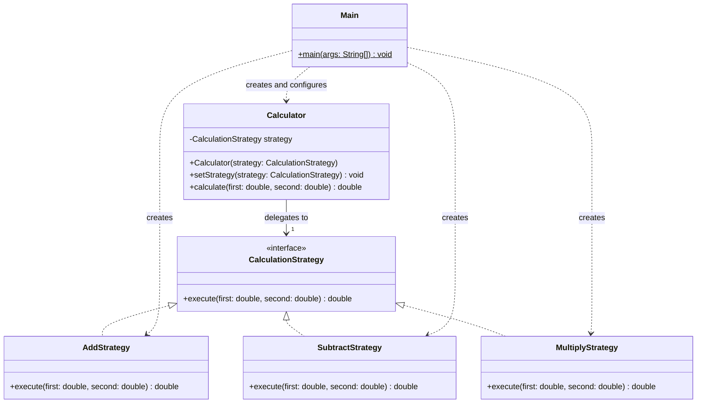

# Assignment 5 - Strategy Pattern

Software Design Patterns | Pashanov Yelnur | SE-2523

## 1. Introduction

The chosen domain is a calculator (Option B). Its algorithm family contains
addition, subtraction and multiplication. Every operation receives two `double`
values and returns one `double` result through `CalculationStrategy.execute`.

`Calculator` is the context. It stores one strategy and delegates calculations
to it. `Main` is the client: it creates a calculator with `AddStrategy`, then
selects `SubtractStrategy` and `MultiplyStrategy` through `setStrategy`.
The same calculator processes the same operands with three algorithms in one run.

## 2. UML class diagram



The dashed triangular arrows represent interface implementation. The solid arrow
represents the context's strategy reference. The other dashed arrows are client
dependencies. `Main` is the Client, `Calculator` is the Context, and the three
operation classes are Concrete Strategies. GitHub renders this Mermaid diagram.

## 3. Clean Code

### 3.1 Replace algorithm-selection conditions with polymorphism

```java
public double calculate(double first, double second) {
    return strategy.execute(first, second); // Delegate through the interface.
}
```

`Calculator` contains no `if`, `switch`, operation codes or type checks.
Java dispatches the call to the selected strategy. Adding an operation does not
extend a conditional chain in the context.

### 3.2 Use intention-revealing names

```java
calculator.setStrategy(new SubtractStrategy()); // Select subtraction explicitly.
```

`SubtractStrategy` states the algorithm, `setStrategy` states the change, and
`first` and `second` make operand order clear. Names such as `Mode2` or `doIt`
would hide those intentions, especially for subtraction.

### 3.3 Give each class a single responsibility

```java
public double execute(double first, double second) {
    return first * second; // This strategy only multiplies.
}
```

`MultiplyStrategy` owns one algorithm. It does not read input, print output or
select other strategies. The context delegates, and `Main` configures the demo
and prints results. A change to output formatting belongs only in the client.

### 3.4 Keep the context independent of concrete algorithms

```java
private CalculationStrategy strategy; // Depend on the shared abstraction.

public void setStrategy(CalculationStrategy strategy) {
    this.strategy = Objects.requireNonNull(strategy);
}
```

The context stores the interface, not an `AddStrategy` or another concrete type.
It can use any implementation of the same contract. The null check protects the
required strategy reference; it does not choose an algorithm. An invalid null
replacement is rejected before it can overwrite the current strategy.

### 3.5 Extend behavior without changing existing classes

A new strategy can be added as `PowerStrategy.java`:

```java
package calculator;

public class PowerStrategy implements CalculationStrategy {
    @Override
    public double execute(double first, double second) {
        return Math.pow(first, second); // A new algorithm behind the same contract.
    }
}
```

A separate `PowerDemo.java` client demonstrates it without editing `Main`:

```java
package calculator;

public class PowerDemo {
    public static void main(String[] args) {
        Calculator calculator = new Calculator(new AddStrategy());
        System.out.println(calculator.calculate(2, 3)); // 5.0
        calculator.setStrategy(new PowerStrategy());
        System.out.println(calculator.calculate(2, 3)); // 8.0
    }
}
```

Place both new files in `src/calculator`, rebuild with the README command, then
run `java -cp out calculator.PowerDemo`. No existing class needs modification.
This illustrates the Open/Closed Principle: the behavior is open to extension,
while the existing implementation stays unchanged. These two classes are a
documentation example, not part of the three-operation application.

## 4. Strategy vs. State

Strategy and State both use composition and delegation, but their intentions
differ. Strategy selects an interchangeable algorithm for the same task. State
models behavior that depends on an object's current state and its transitions,
such as an order moving from pending to paid. This calculator has no lifecycle
or state-transition rules. The client independently chooses addition,
subtraction or multiplication, so Strategy fits the problem. The strategies
do not change the calculator's state or select the next operation themselves.

## 5. Conclusion

The design separates algorithm selection from execution. One calculator can
change operations at runtime, and new algorithms can be added without changing
the context. The tradeoff is additional classes: one interface, three strategy
classes, a context and a client. For three simple arithmetic operations this is
more structure than a direct expression needs, but it makes the Strategy roles
and extension mechanism explicit. The project therefore keeps only those six
Java files and uses no external dependencies.

**Validation:** the six source files compile on JDK 17 with all compiler warnings
enabled and treated as errors. The demo prints 16.0, 8.0 and 48.0. Separate local
checks cover negative and fractional operands, zero, repeated strategy switching,
null rejection, and the extension example above.

## 6. GitHub repository

[aokoshi/strategy-calculator](https://github.com/aokoshi/strategy-calculator)
